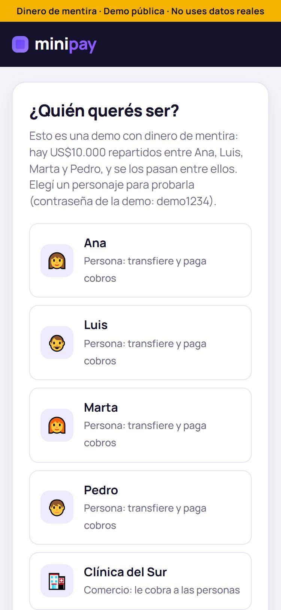
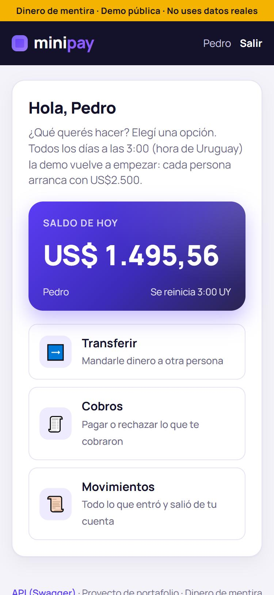
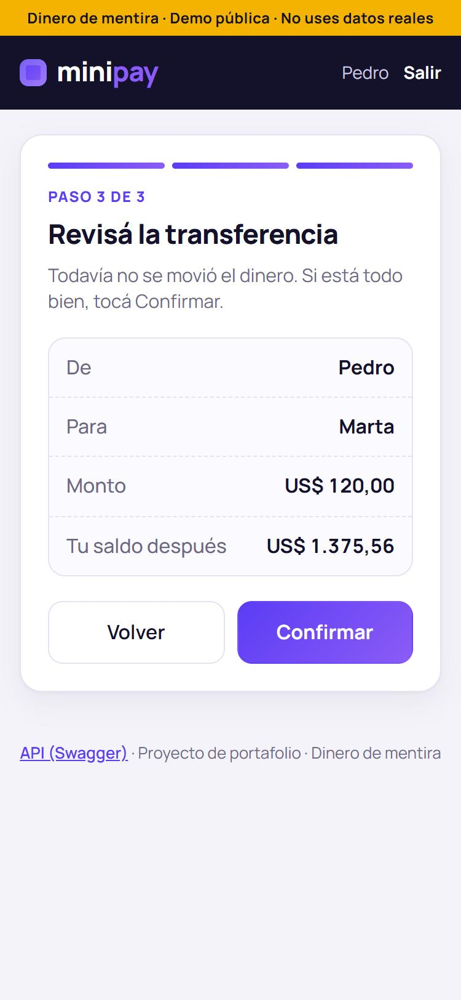
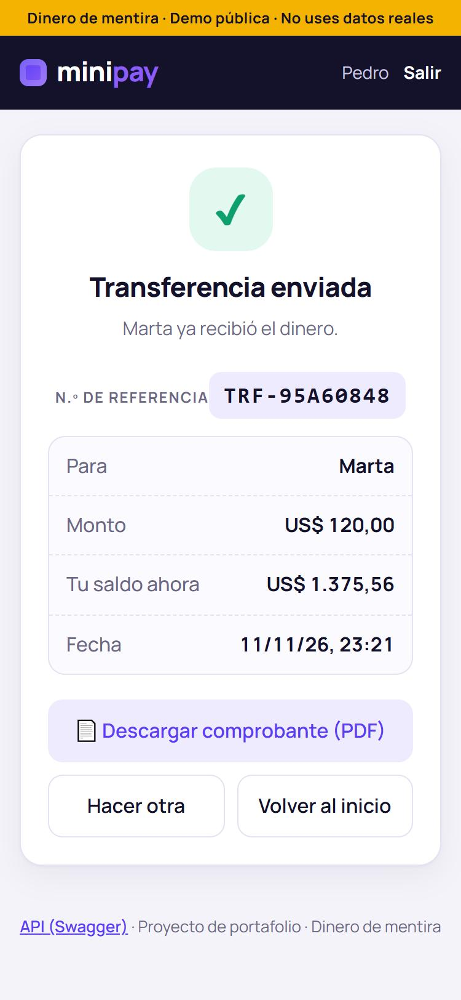
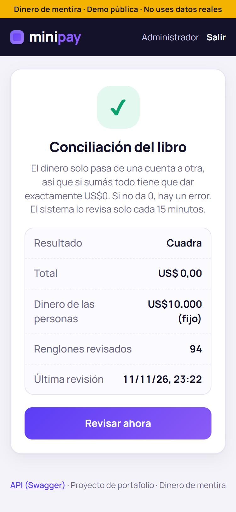

# minipay

**A toy-money digital wallet built to show a payments backend done right:** nothing is charged twice, no balance ever drifts, and every movement is recorded forever.

> ⚠️ **Fake money. Public demo.** Do not enter real data.

[](https://github.com/kelvismoncayo95/minipay/actions/workflows/tests.yml)

**Live demo:** **https://minipay-kcxy.onrender.com** · **API docs (Swagger):** [/docs](https://minipay-kcxy.onrender.com/docs)

*(The free hosting tier sleeps after inactivity: the first request can take ~50 seconds.)*

| Pick a character | Wallet | Review before confirming | Result + receipt | Ledger check (admin) |
|---|---|---|---|---|
|  |  |  |  |  |

*(UI in Spanish: the demo is aimed at a Spanish-speaking audience.)*

---

## Try it

Pick a character on the home screen. Password for every demo user: `demo1234`.

| User | Role | What they can do |
|---|---|---|
| `ana`, `luis`, `marta`, `pedro` | person | send money to each other, pay or reject charges, download PDF receipts |
| `clinica-del-sur` | merchant | charge a person, refund a paid charge |
| `admin` | admin | check that the whole ledger still sums to zero |

**How the demo money works:** there are **US$10,000** shared by Ana, Luis, Marta and Pedro (US$2,500 each). Money only moves between accounts — it is never created out of thin air. Every day at **3:00 a.m. (Uruguay time)** the demo starts over **without deleting anything**: a compensating "daily reset" entry brings every account back to its starting balance.

**Limits:** transfers between people US$500 per operation / US$1,000 per day · payments to merchants US$1,000 per charge / US$2,000 per day (counted separately).

---

## What this project demonstrates

| Problem | How minipay solves it |
|---|---|
| Balances that drift | **Double-entry ledger**: every movement has lines that sum to zero; balances are *computed*, never stored. |
| Rounding errors | Money is stored as **integer cents** (`BIGINT`), never `float`. |
| Charging twice (double click, network retry) | **Idempotency keys** (`Idempotency-Key` header) + `INSERT … ON CONFLICT DO NOTHING`. |
| Two transfers at the same time overdrawing an account | **Row locks** (`SELECT … FOR UPDATE`) taken in a fixed order to avoid **deadlocks**. A concurrency test **fails if the lock is removed** (verified). |
| Paying (or refunding) the same charge twice | The charge row is locked and its state machine (`pending → paid → refunded`, or `rejected` / `expired`) is checked inside the transaction; database `CHECK` constraints enforce it too. Verified with a concurrency test. |
| "Proof of payment" | One-page **PDF receipts** generated on demand (ReportLab), only for the people involved (others get 404). |
| Lost history | **Append-only ledger**: nothing is updated or deleted; corrections are new entries. |
| Undetected bugs in production | A background **worker** reconciles the whole ledger every 15 minutes (it must sum to exactly 0). |
| Guessable IDs | **UUIDv4** primary keys (no enumeration attacks). |
| Leaked secrets | Secrets only in environment variables; **gitleaks** scans the full git history in CI. |

## Tech stack

Python 3.12 · FastAPI · PostgreSQL 17 · SQLAlchemy 2 + Alembic · Redis + Arq (background worker) · bcrypt + JWT · vanilla HTML/CSS/JS frontend · pytest · Docker Compose · GitHub Actions · Render + Neon + Upstash.

## Architecture

```
Browser (HTML/CSS/JS)  ──►  FastAPI  ──►  PostgreSQL (ledger, accounts, charges…)
                              │
                              └── Redis ◄── Arq worker (reconciliation every 15 min, daily reset at 3:00 UY)
```

- `app/api/` — thin HTTP endpoints (validate → call a service → respond)
- `app/services/` — business rules (ledger, transfers, charges, idempotency, daily reset)
- `app/models/` — SQLAlchemy tables · `alembic/` — versioned migrations
- `app/worker/` — background tasks · `app/static/` — frontend
- `tests/` — 134 tests against a real PostgreSQL (each test runs in a rolled-back transaction)

## Main endpoints

| Endpoint | What it does |
|---|---|
| `POST /auth/login` · `GET /auth/me` | log in (JWT) · who am I |
| `GET /me/balance` · `GET /me/movements` | my balance · today's movements (`?all=true` for full history) |
| `POST /me/transfers` | send money (requires `Idempotency-Key`) |
| `POST /merchant/charges` · `GET /merchant/charges` | (merchant) create / list charges |
| `POST /merchant/charges/{id}/refund` | (merchant) full refund of a paid charge (requires `Idempotency-Key`) |
| `GET /me/charges` · `POST /me/charges/{id}/pay` · `POST /me/charges/{id}/reject` | pay or reject a charge |
| `GET /me/receipts/{transaction_id}` | PDF receipt of a transfer, payment or refund |
| `GET /admin/reconciliation` · `POST /admin/reconciliation` | (admin) ledger check |
| `GET /demo/info` | demo rules (amounts, limits, next reset) |

## Run it locally

```bash
git clone https://github.com/kelvismoncayo95/minipay.git
cd minipay
cp .env.example .env            # then fill in the values (see comments inside)
python3 -m venv venv && source venv/bin/activate
pip install -r requirements-dev.txt

docker compose up -d            # api + worker + postgres + redis → http://localhost:8000
pytest -q                       # tests use a separate database: <name>_test
```

## Deliberately left out

- **Webhooks to merchants:** the demo merchant has no external server to receive them. The design would be: an outbox table written in the same transaction as the payment, delivered by the worker with retries and an HMAC signature.
- **Partial refunds, multiple currencies, real sign-up:** out of scope for v1.

## Design docs (Spanish)

- [docs/BackendSchema.md](docs/BackendSchema.md) — every table and every decision, with the *why*
- [docs/Plan.md](docs/Plan.md) — the build plan, step by step

## License

[MIT](LICENSE) © 2026 Kelvis Moncayo
